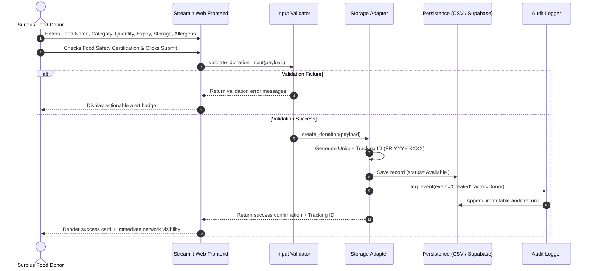
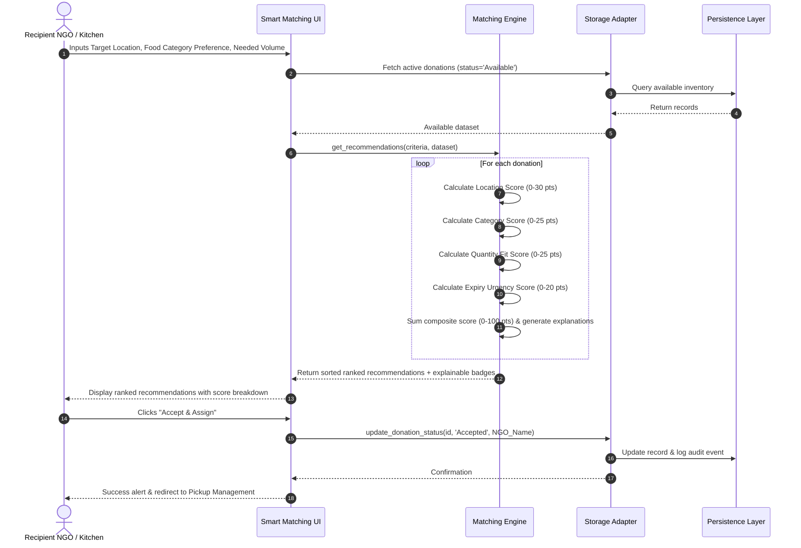
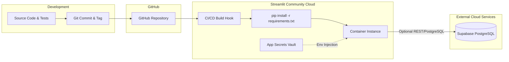

# FoodRescue Cloud — Cloud Architecture Specification

## 1. Executive Summary & Architectural Philosophy
**FoodRescue Cloud** is an event-driven, cloud-native surplus food redistribution and community logistics platform. Designed to demonstrate practical cloud computing and software engineering concepts for academic evaluation, the system bridges the structural information gap between surplus food generators (restaurants, bakeries, corporate dining facilities, institutional canteens) and community recipients (NGOs, food banks, shelters, and volunteer transport networks).

The architecture is built upon three foundational tenets:
1. **Decoupled Three-Tier Topology:** Strict separation between Presentation (Streamlit UI/UX), Business Logic (Validation, State Machine, Heuristic Matching), and Persistence (Dual Storage Adapter).
2. **Graceful Elastic Degradation:** Zero-setup local operation via persistent CSV data files with automated seed restoration, capable of dynamically scaling to a managed cloud database (**Supabase PostgreSQL**) when cloud credentials are provided.
3. **Transparent & Auditable Processing:** Explainable, deterministic rule-based matching algorithms and immutable event ledger logs rather than black-box models.

---

## 2. System Architecture Diagram (Mermaid)

```mermaid
graph TD
    subgraph Client_Layer["1. Client Layer (Multi-Persona Web & Mobile)"]
        D[Donor: Restaurants & Cafes]
        N[NGO: Shelters & Food Banks]
        V[Volunteer: Drivers & Couriers]
        A[Admin: Faculty & System Audit]
    end

    subgraph PaaS_Hosting["2. Cloud PaaS Hosting (Streamlit Community Cloud)"]
        LB[Cloudflare CDN & TLS Termination]
        ST_APP[Streamlit Serverless Container Engine]
        UI[Responsive Food-Tech SaaS UI / CSS Design System]
        ROLES[Demo Role Simulation Switcher]
    end

    subgraph App_Logic["3. Application Core & Business Logic"]
        VAL[Data Validator & Sanitizer]
        SM[Donation State Machine\nAvailable -> Accepted -> Picked Up -> Completed]
        MATCH[Explainable Heuristic Matching Engine\nLocation 30% | Category 25% | Qty 25% | Urgency 20%]
        ANALYTICS[Environmental Impact & Plotly Analytics Engine]
        AUDIT[Immutable Event Audit Logger]
    end

    subgraph Data_Layer["4. Dual Storage Abstraction Layer"]
        ADAPTER{Storage Backend Adapter\nsrc/storage.py}
        CSV_STORE[(Local CSV Storage\ndata/donations.csv\ndata/events.csv)]
        SUPABASE_PG[(Cloud Supabase PostgreSQL\nRow-Level Security & Indexes)]
    end

    %% Client to PaaS connections
    D -->|HTTPS / WSS| LB
    N -->|HTTPS / WSS| LB
    V -->|HTTPS / WSS| LB
    A -->|HTTPS / WSS| LB
    LB --> ST_APP
    ST_APP --> UI
    UI --> ROLES

    %% UI to Application Core
    ROLES --> VAL
    VAL --> SM
    UI --> MATCH
    UI --> ANALYTICS

    %% Application Core to Storage
    SM --> AUDIT
    AUDIT --> ADAPTER
    SM --> ADAPTER
    MATCH --> ADAPTER
    ANALYTICS --> ADAPTER

    %% Storage Resolver
    ADAPTER -->|Default / Fallback Mode| CSV_STORE
    ADAPTER -->|When Secrets Configured| SUPABASE_PG
```

---

## 3. Layer-by-Layer Architectural Breakdown

### 3.1 Presentation & Client Tier
- **Technology:** Streamlit 1.38+, Custom CSS3 Design System, HTML5, Responsive Flexbox/Grid.
- **Hosting Environment:** Streamlit Community Cloud (Linux containerized microVM).
- **Session State Management:** `st.session_state` preserves runtime variables (active role, reactive dataset, event history) across page navigation without unnecessary disk re-reads.
- **Responsive Viewport:** Mobile and laptop optimized layouts, high-contrast accessible typography, dynamic status pills, and empty-state placeholders.

### 3.2 Application Logic & Computation Tier
- **Data Validation Engine (`validate_donation_input`):**
  - Rejects null/empty names, past expiry timestamps, negative portion counts, and uncertified submissions.
  - Generates collision-resistant tracking IDs formatted as `FR-YYYY-XXXX`.
- **Donation Lifecycle State Machine (`update_donation_status`):**
  - Enforces strict unidirectional status transitions:
    $$\text{Available} \longrightarrow \text{Accepted} \longrightarrow \text{Picked Up (In Transit)} \longrightarrow \text{Completed}$$
  - Guard transitions prevent invalid jumps (e.g. `Completed` cannot revert to `Available`).
- **Explainable Smart Matching Engine (`score_donation_match`):**
  - Evaluates open food surplus against recipient logistical constraints using a deterministic 100-point composite function:
    $$\text{Score} = \text{Location (30 pts)} + \text{Category (25 pts)} + \text{Quantity (25 pts)} + \text{Urgency (20 pts)}$$
  - Delivers complete auditability with transparent scoring explanations.
- **Environmental Impact Analytics (`calculate_impact_summary`):**
  - Standardizes diverse measurement units (`kg`, `meals`, `boxes`, `packets`, `litres`) to kg-equivalents.
  - Applies United Nations Environment Programme (UNEP) and WRAP conversion standards:
    - $\approx 2.50\text{ kg CO}_2\text{e}$ greenhouse gas emissions averted per kg of food rescued.
    - $\approx 1,000\text{ Liters}$ of agricultural fresh water footprint conserved per kg.
    - $0.40\text{ kg}$ edible food per nutritional serving.

### 3.3 Data Storage & Persistence Tier
- **Pluggable Dual-Backend Adapter Pattern:**
  - **Zero-Setup Mode (Local CSV):** Reads and writes to `data/donations.csv` and `data/events.csv`. Automatically detects missing or empty files and re-seeds rich demonstration data.
  - **Enterprise Cloud Mode (Supabase PostgreSQL):** Reads `SUPABASE_URL` and `SUPABASE_KEY` from Streamlit Cloud Secrets or `.env`. Interacts with tables via REST/PostgREST.
  - **Graceful Fallback:** If cloud credentials fail, time out, or throw network errors, the application seamlessly reverts to Local CSV mode without user-facing downtime.

---

## 4. End-to-End Workflow Sequence Diagrams

### 4.1 Surplus Food Donation Flow


### 4.2 Heuristic Recommendation & Claiming Flow


---

## 5. Cloud Deployment & Scaling Strategy



### 5.1 Deployment Matrix
| Attribute | Specification |
| :--- | :--- |
| **Compute Platform** | Streamlit Community Cloud (Serverless container runtime) |
| **Source Control** | GitHub Public or Private Repository |
| **Entry Point** | `app.py` |
| **Python Version** | Python 3.10+ (Tested on 3.10, 3.11, 3.15) |
| **Build Configuration** | Dependencies resolved from `requirements.txt` |
| **Secret Configuration** | Managed via Streamlit Cloud Dashboard (`Settings` ➔ `Secrets`) |
| **Zero-Downtime Rebuilds** | Automatic trigger on `git push origin main` |

---

## 6. Security & Governance Considerations
1. **Zero Secret Hardcoding:** No database passwords, tokens, or API credentials exist within the codebase. The `.gitignore` file explicitly blocks `.env` and `.streamlit/secrets.toml`.
2. **Input Sanitization:** All text inputs are stripped and validated to prevent script injection. Date formats are strictly validated against runtime calendars.
3. **Role Simulation Disclosure:** The sidebar role switcher is explicitly labeled as a **demonstration simulation** rather than a cryptographic authentication provider. For production commercialization, OAuth 2.0 / JWT integration via Supabase Auth is documented in `supabase_schema.sql`.
